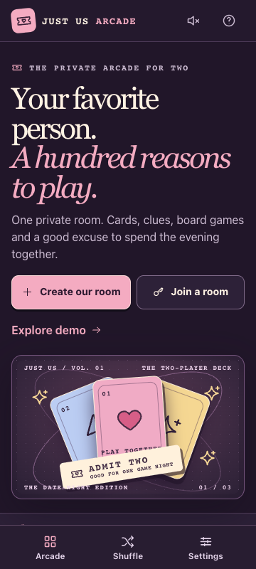
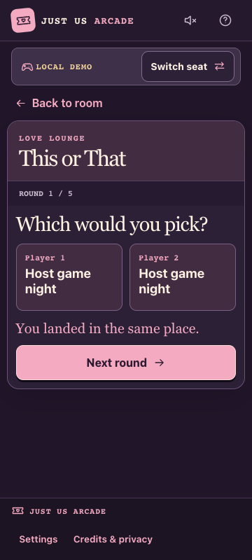

# Just Us Arcade

A mobile-first arcade for two. Play on separate phones or pass one device back and forth. There are **57 playable games and quiz categories** across eight worlds, plus 13 entries marked Coming Soon.

<p>
  
  
</p>

## What you can play

- **Quick games** such as This or That, Connect Four, Checkers, Five in a Row, Higher or Lower, and Memory Match.
- **Creative and cooperative games** such as Draw & Guess, Paint Together, and Escape Together.
- **Trivia and daily puzzles** including Bollywood, Science & Space, and the Daily Word Puzzle.

Use the same room for rematches, or use **Game Night Shuffle** to pick what to play next. After Dark games open when both players opt in. [See the full game roster](GAME_STATUS.md).

## Play on two devices

1. Open the deployed HTTPS site, select **Create our room**, and send the invitation link to your partner.
2. Your partner opens the link, picks a nickname, and sends you the generated reply code.
3. Paste the reply code and tap **Connect room**. Pick a game, tap **I’m ready** on both devices, and have the host start.

Share invitations and replies privately. The connection is encrypted over WebRTC and uses Cloudflare’s public STUN endpoint for network discovery. If pairing stalls, try another Wi-Fi or mobile data connection.

Keep both tabs open during play. Refreshing or closing a tab ends the connection and requires a new invitation. Favorites and preferences stay in each browser. Room progress and answers are temporary.

## Run locally

From the project folder, use Node.js 22.18 or later.

```sh
npm ci
npm run dev
```

Open the URL printed in Terminal. Choose **Explore demo** to play on one device and **Switch seat** to hand it to the other player.

## Deploy to Netlify

Import the GitHub repository into Netlify. The included configuration runs `npm run build` and publishes `dist/`. Leave environment variables empty. The app uses static hosting and requires zero API keys, databases, or player accounts.

For a manual deployment, run `npm ci` and `npm run build`, then upload the resulting `dist/` folder. [Netlify setup guide](NETLIFY_DEPLOY.md).

## Check the project

```sh
npm run lint
npm run typecheck
npm test
npm run content-validation
npm run build
```

The Playwright tests cover the phone layout, direct pairing, and shared gameplay in two separate browser sessions. [Test report and browser test commands](TEST_REPORT.md).

[Content editing guide](CONTENT_GUIDELINES.md) · [Asset credits](ASSET_CREDITS.md)
